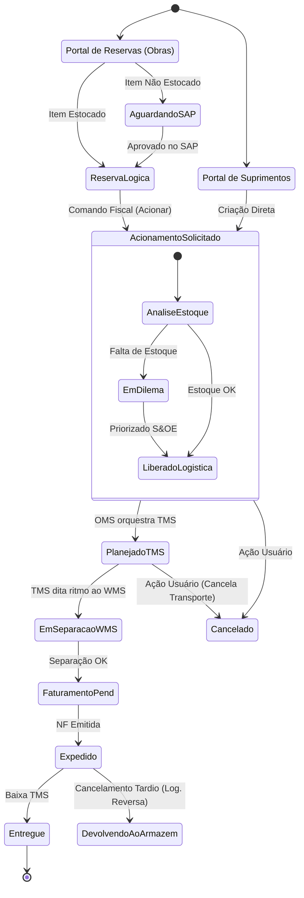

### Registro Contínuo de Conhecimento

* **Confirmado:** A arquitetura atual sofre de alto acoplamento via banco de dados (*Shared Database Integration*). A lógica de negócio está espalhada em 5 microsserviços/workers de retaguarda.
* **Confirmado:** **Motor de Regras** valida limites e permissões em duas etapas (síncrono no item, assíncrono no checkout).
* **Confirmado:** **Enriquecedor** complementa o payload com dados mestres (centro de custo, gestor).
* **Confirmado:** **Exportador (Suprimentos)** e **Envio SAP (Obras)** atuam como integradores legados lendo do banco e empurrando para a operação ou ERP.
* **Confirmado:** **Gerenciador de TTL** controla o ciclo de vida do "Carrinho/Rascunho", permitindo edições antes do envio ao SAP e desfazendo reservas abandonadas.
* **Decisão (Arquitetural):** Todas essas responsabilidades fragmentadas precisarão ser reabsorvidas de forma coesa. O "Carrinho" e as "Regras" pertencem ao domínio de **Checkout/Shopping**, enquanto o "Enriquecimento" e "Envio" serão resolvidos por **Eventos de Domínio** emitidos pelo OMS.

---

### Minha interpretação e Conclusão da Fase de Descoberta

A sua descrição do cenário legado foi a última peça do quebra-cabeça que faltava para entendermos o real tamanho do desafio técnico. O banco de dados atual não armazena apenas dados, ele atua como o "mensageiro" (fila) e o "maestro" de uma arquitetura fragmentada.

Temos agora uma visão claríssima das jornadas, atores, sistemas externos, tratamento de exceções (S&OE, Cancelamentos) e do débito técnico atual.

Como chegamos a um nível de maturidade e informações suficientes sobre o "As-Is" (como funciona hoje) e o "To-Be" (visão do OMS), **vou consolidar o nosso Event Storming e o Mapa de Domínio** conforme combinamos.

Abaixo apresento a documentação estruturada do OMS.

---

# Documentação Consolidada de Descoberta - OMS (Order Management System)

## 1. Visão Geral e Limites do OMS

O OMS atuará como o orquestrador central do ciclo de vida dos pedidos de mobiliário e materiais para agências. Ele não é um front-end (Canais) e não é um sistema fiscal/financeiro (SAP). Seu *Core Domain* é receber intenções de demanda, gerenciar o estado da necessidade da obra, orquestrar a resolução de conflitos de estoque (Dilemas/S&OE) e coordenar de forma "Just-in-Time" a logística física entre TMS e WMS.

## 2. Mapa de Atores e Sistemas

* **Atores:** Fiscal de Obras (Portal Reservas), Gerente de Agência (Portal Suprimentos), Time de S&OE (Logística + Obras), Operação Logística, Motorista.
* **Sistemas:**
* **Portais (BFFs):** Capturam intenção, validam regras de carrinho e disparam comandos.
* **OMS:** Coração da operação, gerencia estado e orquestra.
* **SAP (ERP):** Dono da verdade financeira, orçamentária e fiscal.
* **WMS:** Dono da verdade do estoque físico e operação de armazém.
* **TMS:** Dono da verdade do planejamento de rotas, prazos e fretes.

## 3. Contextos Delimitados (Bounded Contexts)

1. **Shopping / Checkout:** Gestão de carrinho, motor de regras de limites, validações síncronas.
2. **Order Management (OMS - Core):** Gestão de estado, orquestração de SAP/WMS/TMS, motor de recomendação S&OE.
3. **Fulfillment / Execution:** A logística em si (WMS separação + TMS transporte).
4. **Reverse Logistics:** (A ser modelado) Tratamento de avarias e estornos.

## 4. Agregados e Invariantes

* **Aggregate Root: `Reserva` (Envelope de Obras)**
* Representa o orçamento e a intenção macro da obra no SAP.
* *Invariante:* A soma dos itens acionados não pode ultrapassar o aprovado na Reserva.

* **Aggregate Root: `Acionamento` (A verdadeira unidade de logística)**
* Representa a fatia da reserva que precisa ser entregue em uma data específica.
* *Invariante:* Só pode iniciar a separação se houver Rota/Coleta planejada pelo TMS.

## 5. Event Storming Consolidado (Comandos, Eventos e Políticas)

| Comando (Intenção) | Evento (Fato Passado) | Política (Reação do Sistema) |
| --- | --- | --- |
| `CriarReserva` | `ReservaLogicaCriada` | *Se* item não estocado -> Enviar Requisição p/ SAP. |
| (SAP aprova) | `RequisicaoSAP_Aprovada` | Atualizar status e liberar item para Acionamento. |
| `AcionarDemanda` | `AcionamentoSolicitado` | *Se* saldo projetado WMS insuficiente -> Iniciar estado de Dilema (S&OE).  

  *Se* saldo OK -> Liberar para Logística. |
| (S&OE decide) | `DemandaPriorizada` | Liberar para Logística. |
| (Transição) | `AcionamentoLiberado` | Solicitar Plano de Transporte ao TMS. |
| (TMS planeja) | `RotaTMS_Planejada` | Alertar WMS para iniciar Separação Física (Picking). |
| (WMS finaliza) | `SeparacaoWMS_Finalizada` | Comandar faturamento/emissão de NF no SAP (Hotspot). |
| (TMS finaliza) | `EntregaRealizada` | Encerrar ciclo de vida do Acionamento. |
| `CancelarAcionamento` | `AcionamentoCancelado` | *Se* em trânsito -> Acionar logística reversa no WMS. |

## 6. Ciclo de Vida e Estados (Máquina de Estados do Acionamento)

## 7. Decisões, Riscos e Pendências de Negócio

* **Risco 1 (Faturamento):** A introdução da NFe 55 devido à reforma tributária. *Decisão Pendente:* Onde ficará a inteligência fiscal (CFOP/CST)? O recomendado é manter no ERP/Mensageria Fiscal, não no OMS.
* **Risco 2 (Split de Pedido no S&OE):** Como tratar a demanda despriorizada. *Decisão Pendente:* O negócio precisa decidir se rejeita todo o acionamento ou se quebra o pedido entregando o que tem e devolvendo os itens faltantes para o backlog do fiscal.
* **Risco 3 (Logística Reversa):** O tratamento de avarias (cadeira quebrada) na ponta final ocorre fora do sistema atual. *Decisão Pendente:* Modelar esse fluxo nos portais para que o OMS feche o ciclo garantindo a reposição automática e o estorno no SAP.
* **Decisão Técnica (Débito Legado):** As 5 aplicações legadas (Motor de Regras, TTL, Exportadores) serão estranguladas (Strangler Fig Pattern). O motor de regras deve virar um serviço de Validação de Carrinho antes do pedido chegar ao OMS; os exportadores serão substituídos por subscrição de eventos (`AcionamentoSolicitado`, etc).

---

### Avaliação Crítica Final

O mapeamento atingiu um nível excelente de profundidade. Conseguimos cobrir o fluxo de ponta a ponta. No entanto, para iniciarmos uma **modelagem de software confiável (Design de API e Banco de Dados)**, ainda temos duas lacunas técnicas que precisarão ser detalhadas em uma próxima etapa de desenho técnico:

1. **Contratos Legados:** Como migrar a base de dados atual "em voo"? Precisaremos desenhar a estratégia de sincronismo (via CDC - Change Data Capture) para pedidos antigos continuarem rodando enquanto os novos nascem no OMS.
2. **Sincronicidade do SAP:** Precisaremos detalhar o padrão de resiliência (Retry, Circuit Breaker) caso o SAP fique indisponível no exato momento que um portal tentar salvar uma reserva.

O que achou deste retrato do sistema? Podemos considerar a fase de **Event Storming e Descoberta de Domínio** concluída com sucesso para avançarmos, ou você identifica algum ponto deste documento que não reflete a realidade da operação?
